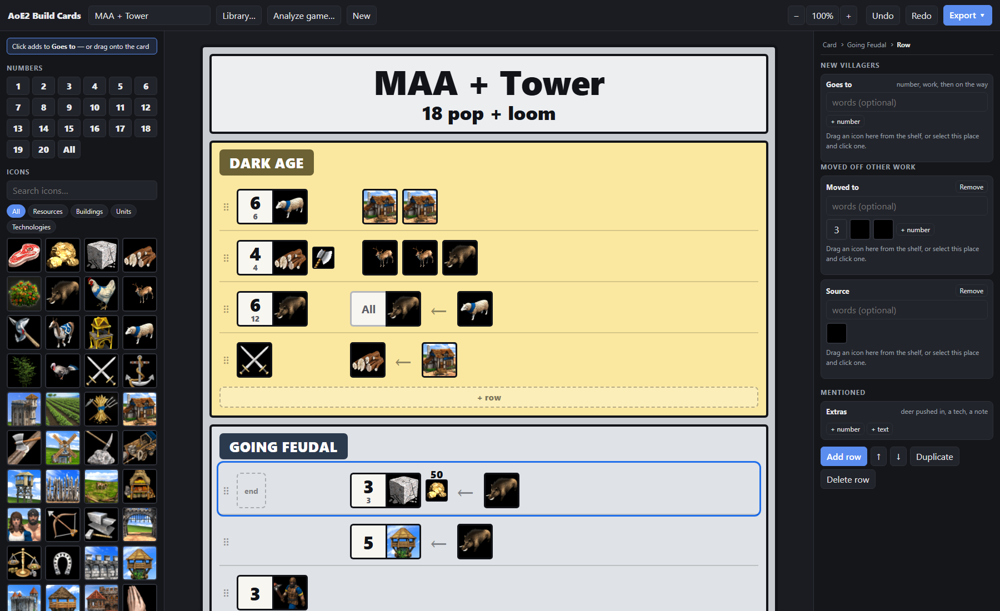

# AoE2 Build Cards

Build-order cards for Age of Empires II: Definitive Edition — the rows of
icons under coloured age bands that players share as images — drawn in the
browser, exported as PNG or PDF, and **read straight out of a recorded game**.



- **Draw a card**: drag icons and numbers onto rows of three columns — new
  villagers and any who joined them (*4 boar ← 3 sheep*), villagers moved
  somewhere else (*where to ← source*), and what
  the row only mentions; the small figure under each number keeps count of
  the villagers on that work (sheep, hunt, berries, farms, pastures, wood
  line, stragglers, gold, stone).
- **Analyze a game**: find a player by name and filter their last four months
  of games by format, flank/pocket, civ and map — or paste a match link, or
  open a replay file — and every player's plan is listed ("men-at-arms →
  archers", "boom → knights", "tower rush → boom", "douche"). Pick one and
  their opening becomes a card: every villager move, building, tech and
  age-up, and the villagers sent forward to the enemy.
- **Export** a card as an image, a print-ready PDF, or a JSON file to share.

Cards live in your browser's local storage. Nothing is uploaded anywhere: the
replay reader runs on your own machine.

## What you need

**git**, **Python 3.12 or newer** and **Node.js 20.19+ or 22.12+**. See what
you already have — each prints a version if it is installed:

```
git --version
python --version        # python3 --version on macOS and Linux
node --version
```

Install whatever is missing or older than that.

**Windows** — in PowerShell, with `winget`, which comes with Windows 10 and
11. An installer may ask for administrator permission.

```powershell
winget install --id Git.Git -e
winget install --id Python.Python.3.14 -e
winget install --id OpenJS.NodeJS.LTS -e
```

A window that was already open does not see what was just installed, and
neither does a new terminal inside VS Code until VS Code itself is restarted.
Open a fresh PowerShell window, or reload the PATH in the one you have:

```powershell
$env:Path = [Environment]::GetEnvironmentVariable("Path", "Machine") + ";" + [Environment]::GetEnvironmentVariable("Path", "User")
```

**macOS** — with [Homebrew](https://brew.sh/). If `brew --version` finds
nothing, the first line installs it:

```bash
/bin/bash -c "$(curl -fsSL https://raw.githubusercontent.com/Homebrew/install/HEAD/install.sh)"
brew install git python@3.14 node
```

**Linux** — git and Python from your distribution, and Node.js through
[nvm](https://github.com/nvm-sh/nvm), since a distribution's own is often too
old (Ubuntu 24.04's is 18). On Debian or Ubuntu:

```bash
sudo apt update && sudo apt install git python3 python3-venv
curl -o- https://raw.githubusercontent.com/nvm-sh/nvm/v0.40.8/install.sh | bash
# then in a new terminal:
nvm install --lts
```

On Fedora the first line is `sudo dnf install git python3`. Debian 12's
Python is 3.11, too old; Debian 13 and Ubuntu 24.04 are new enough.

## Set it up (once)

Windows PowerShell:

```powershell
git clone https://github.com/DanielSery/aoe2-build-cards.git
cd aoe2-build-cards
python -m pip install -r requirements.txt
cd cards; npm ci; npm run build; cd ..
```

If `python` is not found, use `py` instead — the launcher Python's installer
puts on the PATH. If PowerShell refuses to run `npm` because "running
scripts is disabled on this system", allow scripts you have on your own
computer, once, and try again:

```powershell
Set-ExecutionPolicy -Scope CurrentUser RemoteSigned
```

macOS / Linux — the Python packages go in a folder of the project's own
(`.venv`), since Homebrew's Python and recent Debian and Ubuntu refuse to
`pip install` into the system's:

```bash
git clone https://github.com/DanielSery/aoe2-build-cards.git
cd aoe2-build-cards
python3 -m venv .venv
.venv/bin/pip install -r requirements.txt
(cd cards && npm ci && npm run build)
```

If `python3 --version` says older than 3.12, name the newer one instead:
`python3.14 -m venv .venv`.

`npm run build` writes the app to `cards/dist/`. Run it again after pulling
changes to the app.

## Run it

From the repository folder — on Windows:

```powershell
python -m uvicorn replays.server:app --port 8030
```

on macOS and Linux:

```bash
.venv/bin/python -m uvicorn replays.server:app --port 8030
```

and once it prints `Uvicorn running on http://127.0.0.1:8030`, open
**<http://localhost:8030/>** in your browser. The server serves the app and the
replay reader together; leave the window open while you use it and stop it
with `Ctrl+C`.

On Windows, this opens the page for you a few seconds after the server starts:

```powershell
Start-Job { Start-Sleep 4; Start-Process "http://localhost:8030/" } | Out-Null
python -m uvicorn replays.server:app --port 8030
```

If port 8030 is taken, pick another (`--port 8040`) and open that one instead.

## Using it

- **Analyze game…** in the top bar:
  - **Find a game** — a player's name or profile id. Filters are optional; a
    game's plan appears under it as you scroll to it, since its replay has to
    be downloaded and read first.
  - **Paste a link** — an aoe2companion or aoe2insights match link, the aoe.ms
    replay link, or the match id.
  - **Open a file** — an `.aoe2record` from your own games (usually under
    `Games\Age of Empires 2 DE\<your id>\savegame`), or drop it anywhere on the page.
- Pick a player: their opening opens as a card marked *not saved*. **Save**
  keeps it in your library; reading another player replaces it.
- **Library…** lists your cards; tick some and press `Ctrl+P` for one PDF.
- **Export ▾** — the card as an image, a print, or a card file to send someone
  (they open it with *Library… → Import JSON…*).

Microsoft keeps replays for a few months, so older games can't be read.
Downloaded replays and match records are cached in `.data/replays/` (about
5 MB a game); delete that folder whenever you like.

### How far to trust a card

A replay holds the commands players gave, not the game state. Buildings,
techs, age-up times and who was sent where are read directly; **how many
villagers** there were is inferred, because a queue click without the food is
recorded like one with it. The plans in the player list count queued units the
same way, and their thresholds are judgement rather than measurement.

## Working on it

On macOS and Linux, `python` below is `.venv/bin/python`.

```powershell
python tools/check.py               # the replay reader's offline checks
python tools/fetch_card_icons.py    # re-download the icons and replays/units.json

cd cards
npm run dev                         # the editor on http://localhost:5173, reloading as you
                                    # edit; /api goes through to the server on port 8030

npm i --no-save playwright; npx playwright install chromium   # once, for the test below
npm run preview -- --port 8020      # serve the build, then in a second terminal:
node shot.mjs                       # drives the editor headlessly and exports a PNG and a PDF
```

| Path | What it is |
|---|---|
| `cards/` | the card editor: React + Vite, a static site. Its own [README](cards/README.md) explains the card format |
| `replays/` | the replay reader and HTTP server (FastAPI). `mgzfix.py` patches the `mgz` parser for current replays |
| `aoe2planner/gamedata/` | the game's own data (units, techs, resources), which the reader names things by |
| `tools/` | the icon fetcher and the offline checks |

`CLAUDE.md` holds the design notes: the rules that are easy to break, and why.

## Credits

Age of Empires II © Microsoft Corporation. This is a fan-made tool and is not
endorsed by or affiliated with Microsoft. Icons come from
[SiegeEngineers/aoe2techtree](https://github.com/SiegeEngineers/aoe2techtree)
and the [Age of Empires wiki](https://ageofempires.fandom.com); match data from
[aoe2companion](https://www.aoe2companion.com); replays are read with
[mgz](https://github.com/happyleavesaoc/aoc-mgz); newer gaia are named after
[AoE2ScenarioParser](https://github.com/KSneijders/AoE2ScenarioParser)'s tables.
